<p align="center">
  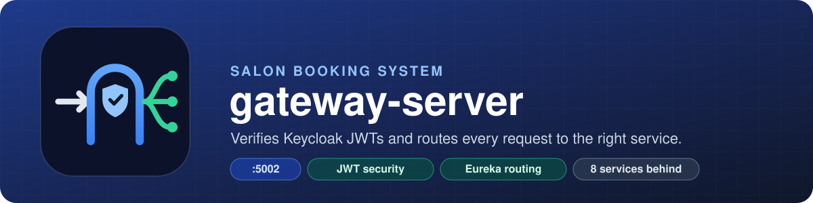
</p>

<p align="center">
  
  
  
  
  
  
</p>

<p align="center">
  <a href="#1-the-whole-system-on-one-page">Architecture</a> ·
  <a href="#2-one-request-step-by-step">Request flow</a> ·
  <a href="#3-access-rules">Access rules</a> ·
  <a href="#4-routes">Routes</a> ·
  <a href="#5-how-a-keycloak-token-becomes-spring-roles">Roles</a> ·
  <a href="#6-run-locally">Run locally</a>
</p>

---

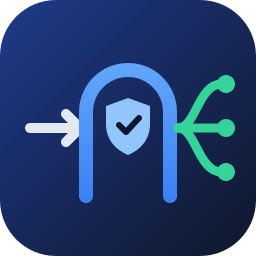

The single entry point of the **salon booking microservices system**. Every request from the web or mobile app comes here first, and the gateway does two jobs, always in this order:

1. 🛡️ **Security**: checks who is calling, using a Keycloak JWT, and whether that role may use the path.
2. 🧭 **Routing**: finds the right microservice through Eureka and forwards the request unchanged.

It holds no business logic and no database.

| | |
|---|---|
| **Port** | `5002` |
| **Eureka name** | `gateway-server` |
| **Stack** | Spring Cloud Gateway (WebFlux) · Spring Boot 3.4.10 · Java 17 |
| **Talks to** | Keycloak `:8080` (token keys) · Eureka `:8070` (service addresses) |
| **Docker image** | `codecaptcha/gateway-server-yt:v1` (Jib) |

---

## 1. The whole system on one page

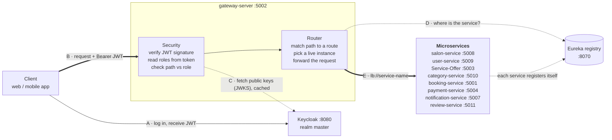

Solid arrows carry the user's request. Dotted arrows are lookups made in the background. Letters **A–E** give the order of events for one logged-in request. The client never talks to the eight services directly.

<details>
<summary>Original design diagram (from the design artifact)</summary>

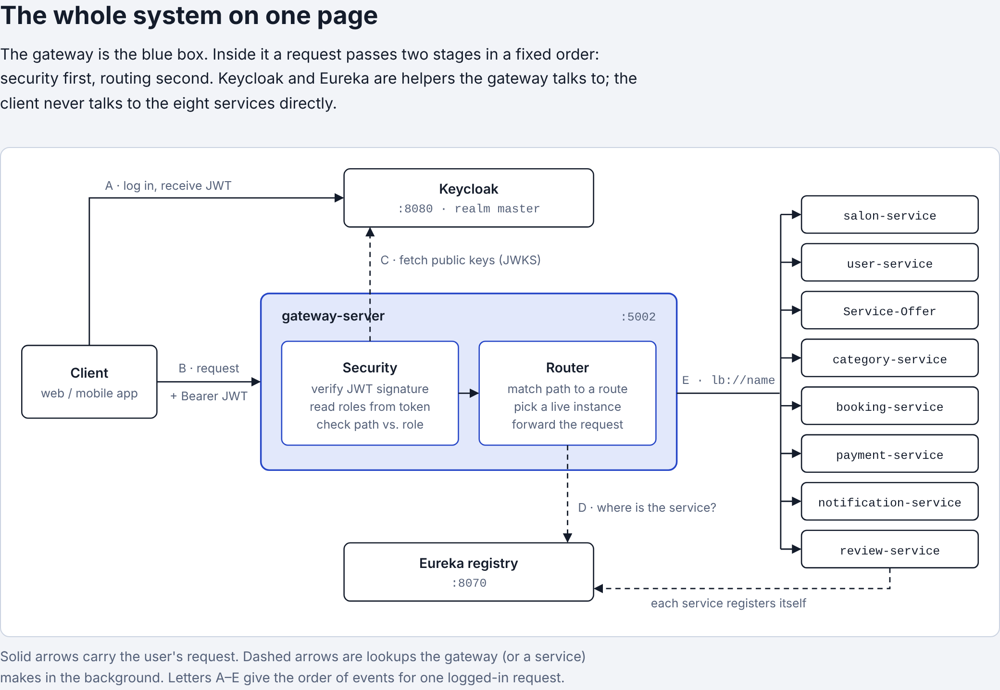

</details>

---

## 2. One request, step by step

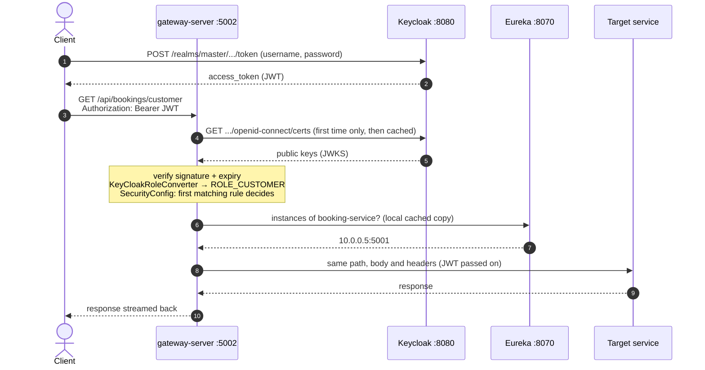

Every step can stop the request early, and the status code tells you which step did it:

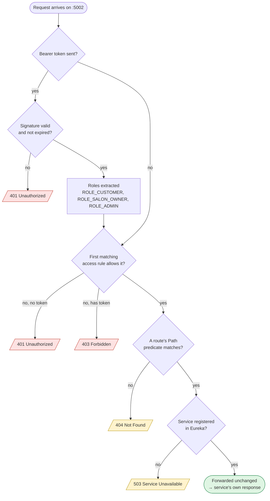

<details>
<summary>Step-by-step explanation (from the design artifact)</summary>

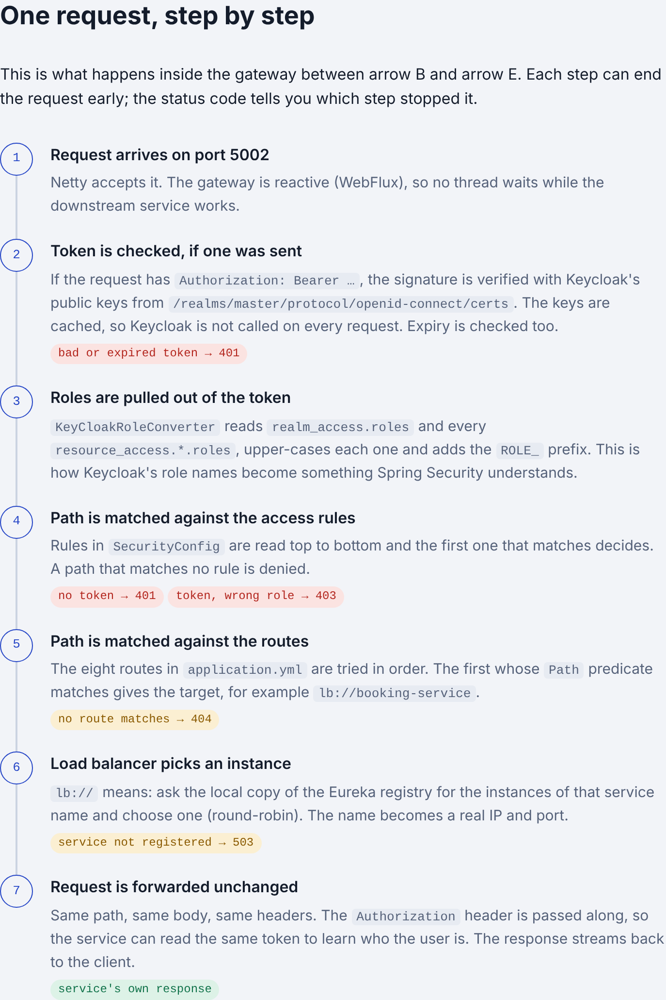

</details>

---

## 3. Access rules

From [`SecurityConfig.java`](src/main/java/com/sohrab/gateway_server/Config/SecurityConfig.java). Spring checks them **top to bottom, and the first rule that matches decides**, so the narrow rules sit above the wide ones. CSRF is disabled (token-based API) and CORS allows the origins in `CORS_ALLOWED_ORIGINS`.

| # | Paths | Who may pass |
|---|---|---|
| 1 | `/auth/**` | everyone (login, signup) |
| 2 | `/api/notifications/ws/**` | everyone (WebSocket handshake) |
| 3 | `/actuator/health/**` | everyone (container health probes) |
| 4 | `/api/payments/create` | **no one** (only booking-service calls it, directly, not through the gateway) |
| 5 | `/api/category/salon-owner/**`, `/api/service-offering/salon-owner/**`, `/api/notifications/salon-owner/**`, `/api/bookings/salon`, `/api/bookings/report` | SALON_OWNER, ADMIN |
| 6 | `POST /api/salons/**`, `PUT /api/salons/**` | SALON_OWNER, ADMIN |
| 7 | `/api/users`, `/api/notifications` (the full lists) | ADMIN |
| 8 | `/api/salons/**`, `/api/category/**`, `/api/notifications/**`, `/api/bookings/**`, `/api/payments/**`, `/api/service-offering/**`, `/api/users/**`, `/users/**`, `/api/reviews/**` | CUSTOMER, SALON_OWNER, ADMIN |
| – | anything else | **no one**: 401 without a token, 403 with one |

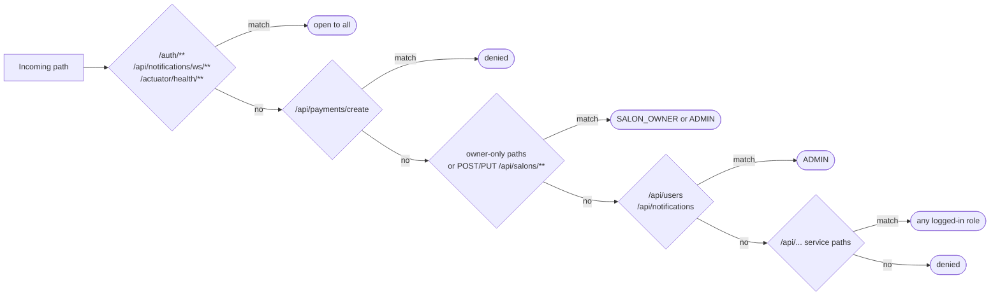

---

## 4. Routes

From [`application.yml`](src/main/resources/application.yml). The path is **not rewritten**: the service receives exactly what the client sent. `lb://` means "look the name up in Eureka and pick an instance round-robin".

| Route id | Path predicates | Target |
|---|---|---|
| SALON-SERVICE | `/salons/**` `/api/salons/**` `/api/admin/salons/**` | `lb://salon-service` |
| USER-SERVICE | `/auth/**` `/api/admin/users/**` `/api/users/**` `/users/**` | `lb://user-service` |
| SERVICE-OFFER | `/api/service-offering/**` | `lb://Service-Offer` |
| CATEGORY-SERVICE | `/api/category/**` | `lb://category-service` |
| BOOKING-SERVICE | `/api/bookings/**` | `lb://booking-service` |
| PAYMENT-SERVICE | `/api/payments/**` | `lb://payment-service` |
| NOTIFICATION-SERVICE | `/api/notifications/**` | `lb://notification-service` |
| REVIEW-SERVICE | `/api/reviews/**` | `lb://review-service` |

> [!IMPORTANT]
> Each service must register in Eureka under **exactly** the name after `lb://` (note `Service-Offer`), otherwise the gateway answers 503.

---

## 5. How a Keycloak token becomes Spring roles

Keycloak puts roles in two places inside the token. [`KeyCloakRoleConverter`](src/main/java/com/sohrab/gateway_server/Config/KeyCloakRoleConverter.java) collects both, upper-cases each role and adds the `ROLE_` prefix, so it doesn't matter whether a role was created at realm level or on a client.

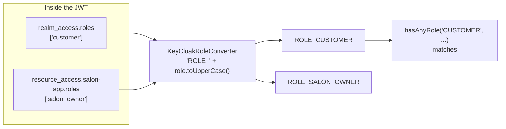

Without the prefix and the upper-casing, every role check would fail with 403.

<details>
<summary>Token example (from the design artifact)</summary>

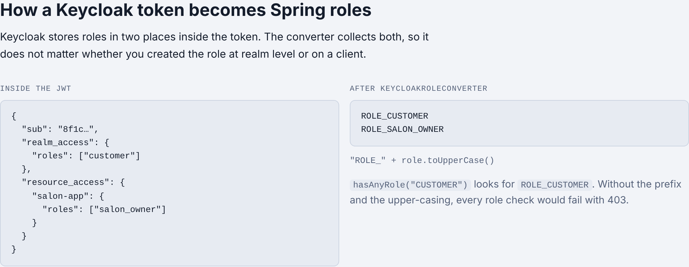

</details>

---

## 6. Run locally

Start the dependencies in this order so the first request works:

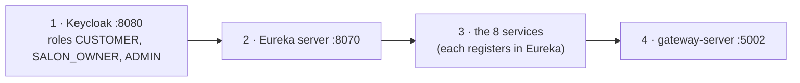

```bash
./mvnw spring-boot:run          # start the gateway
./mvnw test                     # 5 tests, including the security rules
./mvnw compile jib:dockerBuild  # build the Docker image
```

> [!TIP]
> Point the frontend at `http://localhost:5002` and nowhere else. The services' own ports are for internal calls only.

## Configuration

Settings come from environment variables. The gateway needs no secrets: it only reads Keycloak's **public** keys.

| Variable | Default |
|---|---|
| `KEYCLOAK_JWK_SET_URI` | `http://localhost:8080/realms/master/protocol/openid-connect/certs` |
| `EUREKA_URL` | `http://localhost:8070/eureka/` |
| `CORS_ALLOWED_ORIGINS` | `http://localhost:3000` (comma separated) |

In Docker, set both URLs to the container names (for example `http://keycloak:8080/...` and `http://eureka:8070/eureka/`), because `localhost` there is the container itself.

## Known gaps

> [!WARNING]
> - `/salons/**`, `/api/admin/salons/**` and `/api/admin/users/**` have routes but no access rule, so they are denied for everyone, admins included. Add `.pathMatchers("/api/admin/**").hasRole("ADMIN")` once those endpoints are confirmed.
> - The discovery locator is on and creates `/<service-id>/**` routes that no rule allows, so they are unreachable. It can be switched off.
> - Users live in Keycloak's `master` realm. Use a dedicated realm in production.

## Design docs

| | |
|---|---|
| 🗺️ [docs/gateway-server-flow.html](docs/gateway-server-flow.html) | The full interactive design page. Download it and open it in a browser to use the **Try a request** simulator. |
| 📝 [CHANGES.md](CHANGES.md) | What was changed in the gateway and why. |
| 🧪 [curl/](curl/) | Ready-made requests and `run-all.sh` to test the gateway end to end. |

> [!NOTE]
> The design page's *Access rules* table and *What I would fix* list describe the code **before** the fixes in [CHANGES.md](CHANGES.md). The tables in this README match the current code.
